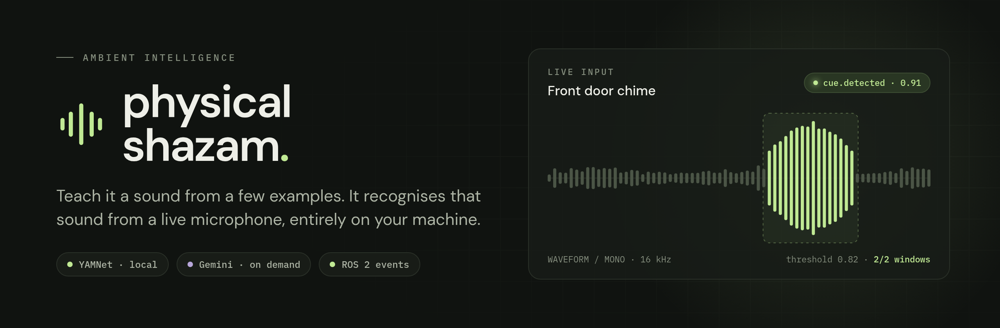
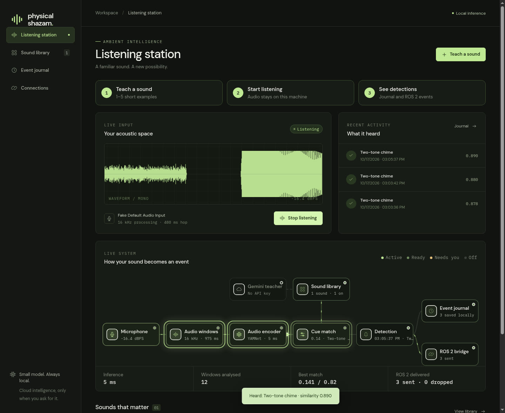
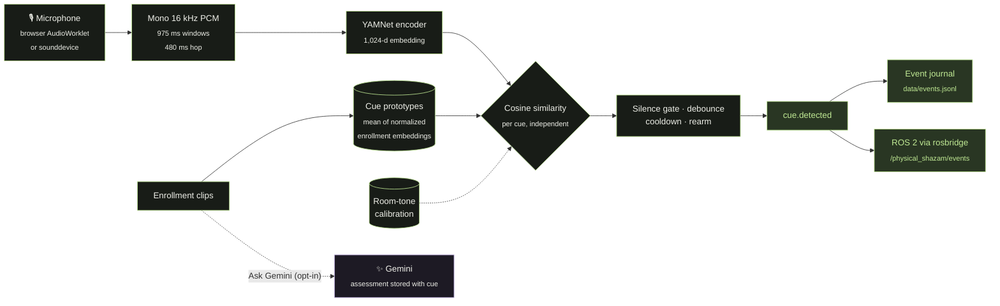

<p align="center">
  
</p>

<p align="center">
  
  
  
  
  
  
  
</p>

<p align="center">
  <b>A familiar sound. A new possibility.</b><br>
  Record 1–5 examples of a sound, optionally ask Gemini to assess them, and recognise the cue from a live microphone<br>
  <i>without sending the live stream to the cloud.</i>
</p>

<p align="center">
  <a href="#quick-start">Quick start</a> ·
  <a href="#try-it">Try it</a> ·
  <a href="#how-it-works">How it works</a> ·
  <a href="#ros-2-output">ROS 2 output</a> ·
  <a href="#headless-microphone-mode">Headless mode</a> ·
  <a href="#verification">Verification</a> ·
  <a href="#scope">Scope</a>
</p>

<br>

<p align="center">
  
</p>

## Two loops, one purpose

<table>
  <tr>
    <td width="50%" valign="top">
      <h3>🟢 The listener <sub><code>LOCAL</code></sub></h3>
      <b>YAMNet + your sound prototypes.</b><br>
      A frozen Google YAMNet encoder embeds the live microphone stream on your machine and scores it against each learned cue. The live stream is never recorded or uploaded.
    </td>
    <td width="50%" valign="top">
      <h3>🟣 The teacher <sub><code>ON DEMAND</code></sub></h3>
      <b>Gemini enrollment guidance.</b><br>
      Only when you click <b>Ask Gemini</b>, the selected enrollment examples go to Gemini, which suggests a label, audible characteristics, confusable sounds and recording advice.
    </td>
  </tr>
</table>

> [!NOTE]
> The two loops are independent by design. Local enrollment and detection work without any cloud access, and starting the listener makes no cloud call.

## Quick start

> **Requires** Python 3.11 (pinned) and [uv](https://docs.astral.sh/uv/), which manages the environment and lockfile.

```sh
uv sync --all-extras
cp -n .env.example .env
uv run physical-shazam serve
```

Open **http://127.0.0.1:8765**. The server binds to IPv4 loopback. To use another port, run `serve --port 8766`.

The first launch downloads the real Google YAMNet model and warms it up; later launches use the TensorFlow Hub cache. The dashboard shows any initialization errors with a retry button. TensorFlow Hub currently needs the pinned `setuptools<81` compatibility dependency.

<details>
<summary><b>Optional: enable Gemini</b></summary>
<br>

Add your key to the local `.env` file, which Git ignores:

```dotenv
GEMINI_API_KEY=your-key
GEMINI_MODEL=gemini-2.5-flash
```

The backend rereads this file for each Gemini request, so changes apply without a restart. Credentials are never returned to the browser or included in event data. You need a Gemini account with access and available quota.

</details>

## Try it

| | Step | What happens |
|:-:|---|---|
| **1** | **Teach a sound**, or click **Or try a lab sample** | Record or upload 1–5 examples (WAV, FLAC or OGG; each 1–30 s and under 12 MB). The lab sample is a synthetic two-tone chime. |
| **2** | **Ask Gemini** *(optional)* | Get a suggested label, audible characteristics, confusable sounds and recording advice. Review it, then add the sound to the library. |
| **3** | **Start listening** | Allow the browser microphone. Press play on a cue card to play its saved example, or make the real sound nearby. Headphones stop the microphone from hearing a played reference. |
| **4** | Watch the scores, then **Tune cue** | The dashboard shows live cosine similarities and an event journal. Tune the threshold, consecutive matching frames and cooldown. Scores are similarities, not probabilities. |
| **5** | Calibrate the room *(optional)* | In **Sound library**, record five seconds of background room tone. A cue then has to exceed its threshold **and** beat the background similarity by 0.05. |
| **6** | **Test a recording** | Evaluate a file without publishing ROS messages or writing to the journal. Try `src/physical_shazam/static/samples/two-tone-test.wav` after enrolling the lab chime, and `room-noise.wav` as a negative. |

> [!TIP]
> Listening pauses while you capture enrollment or calibration audio and resumes when the dialog closes. Clear or redo calibration whenever the room changes. To use a separate workspace, run `physical-shazam --data-dir ./another-workspace serve`.

## How it works



### Detection defaults

These are starting values; tune them with real positives and hard negatives.

| Parameter | Default |
|---|---|
| Similarity threshold | `0.82` |
| Matching windows to trigger | `2` |
| Silence gate | `−55 dBFS` |
| Cooldown | `4 s` |
| Nonmatching windows to rearm | `2` |
| Margin over room tone (when calibrated) | `+0.05` |

<details>
<summary><b>Engine details</b></summary>
<br>

- **Encoder.** The frozen environmental-audio encoder is [Google YAMNet](https://www.tensorflow.org/hub/tutorials/yamnet), which produces 1,024-dimensional embeddings. Enrollment averages normalized embeddings into a cue prototype. Adding a cue leaves existing prototypes intact.
- **Windowing.** Each full 15,600-sample (975 ms) waveform covers YAMNet's 96 spectrogram frames, advancing every 7,680 samples (480 ms), and every full window is embedded. The implementation does not pretend that independent 480 ms waveforms reproduce overlapping YAMNet embeddings.
- **Scoring.** Each cue is scored independently by cosine similarity, so multiple events can fire, but robustness to overlapping sounds still needs empirical testing.
- **Gemini.** Gemini runs asynchronously during enrollment. Its assessment is stored with the cue to help you review recordings and choose negatives. **Gemini text is not projected into YAMNet's audio-only embedding space, and it does not train or distill the encoder.**
- **Latency.** The measured inference time covers model execution and scoring only, not event latency. Because of the input receptive field and debounce, this is not a sub-100 ms trigger system.
- **Frontend.** The dashboard is native HTML/CSS/JavaScript with an AudioWorklet, served by FastAPI. There is no build step. Use a current browser with AudioWorklet support. Google Fonts are loaded for typography; system fonts work offline.

</details>

## ROS 2 output

The Mac publishes through the rosbridge WebSocket protocol, so it doesn't need `rclpy`.

| Topic | Type | Payload |
|---|---|---|
| `/physical_shazam/events` | `std_msgs/msg/String` | Structured JSON in the String's `data` field |

```json
{
  "id": "unique-event-id",
  "type": "cue.detected",
  "cue_id": "learned-cue-id",
  "name": "Front door chime",
  "score": 0.91,
  "timestamp": "2026-10-17T14:00:00+00:00",
  "stream_seconds": 8.175,
  "action": "notify"
}
```

<details open>
<summary><b>No ROS system? Use the bundled mock bridge</b></summary>
<br>

```sh
uv run python -m physical_shazam.mock_bridge
```

Open **Connections**, enable ROS, enter `ws://127.0.0.1:9090` and save. **Send test event** sends a separately typed `connection.test` message, and live detections appear in the sink terminal as `cue.detected`. This verifies transport and serialization; the sink **does not run a ROS graph**.

</details>

<details>
<summary><b>On a real ROS 2 machine</b></summary>
<br>

With `rosbridge_suite` installed:

```sh
ros2 launch rosbridge_server rosbridge_websocket_launch.xml
ros2 topic echo /physical_shazam/events std_msgs/msg/String
```

Point the dashboard at that machine's bridge address.

</details>

**Delivery semantics:**

- The publisher advertises the type before publishing, watches for bridge error messages, and reconnects when the bridge is unavailable.
- Its bounded queue drops stale and offline events rather than replaying old robot actions after a reconnect.
- In the journal, `queued` means the event was handed to the publisher and `sent` counts WebSocket writes. Rosbridge does not acknowledge subscriber receipt, so validate a real subscription with `ros2 topic echo`.

> [!IMPORTANT]
> This prototype does not command any robot movement.

## Headless microphone mode

Enroll cues in the dashboard first, then stop that server before running the headless engine on the same data directory:

```sh
uv sync --all-extras
uv run physical-shazam listen
# Or pick a sounddevice device by index or name:
uv run physical-shazam listen --device 0
```

This mode captures audio with PortAudio/sounddevice, keeps inference outside the audio callback, writes the same event log, and uses the saved ROS configuration. On Linux, you may need to install PortAudio through the OS package manager.

> [!WARNING]
> Run one process per data directory. Headless mode loads cues at startup, whereas enrolling in the dashboard updates the dashboard server's detector immediately.

## Verification

```sh
uv run pytest -q
uv run ruff check src tests scripts
node --test tests/*.test.mjs
uv run python scripts/smoke_test.py
```

| Suite | What it covers |
|---|---|
| **pytest** (27 tests) | Stream boundaries, resampling, cue persistence, independent matches, debounce/rearm/cooldown, silence and background rejection, malformed WebSocket frames, API errors, Gemini failures and response validation, and a real local rosbridge wire exchange. These tests inject an encoder double where recognition accuracy doesn't matter. |
| **Node** (8 tests) | Real HTML element references, cancellation during uploads/recording, concurrent upload limits, stale teacher/save responses, microphone permission resolving after cancellation, and AudioWorklet PCM preservation across chunk boundaries and final flush. |
| **`smoke_test.py`** | Runs the **real pretrained YAMNet** through enrollment, synthetic streaming positives, a noise negative, persisted detection events and a WebSocket bridge sink, in an isolated temporary workspace. |

Dashboard workflow tests use an isolated DOM/network harness; the sample enrollment flow was also checked in Chrome. Actual microphone capture still requires browser permission.

On the development Mac, the smoke test detected both replayed chimes, rejected the noise fixture, and measured about **3 ms median inference per window**. This is a synthetic integration check, not a benchmark of household recall, false accepts per hour, or real ROS delivery. A live Gemini audio assessment was also verified during development.

## Data and privacy

| File | Contents |
|---|---|
| `data/cues.json` | Learned cues and their configuration |
| `data/examples/<cue-id>/*.wav` | Saved enrollment clips (removed when you delete the cue) |
| `data/events.jsonl` | Event journal |
| `data/ros.json` | ROS connection settings |
| `.env` | Gemini credentials |

All of these are ignored by Git. Enrollment clips and cue configurations persist, but the live stream is never recorded. The app has no multiuser authentication, so keep it bound to loopback during local development. API routes and request schemas are at **http://127.0.0.1:8765/docs**.

## Scope

<table>
  <tr>
    <th width="50%">✅ Implemented</th>
    <th width="50%">🔭 Future work</th>
  </tr>
  <tr>
    <td valign="top">
      <ul>
        <li>Manual few-shot enrollment</li>
        <li>Local streaming recognition</li>
        <li>Background rejection</li>
        <li>Cloud assessment (Gemini)</li>
        <li>Persistence</li>
        <li>Event transport (ROS 2 via rosbridge)</li>
      </ul>
    </td>
    <td valign="top">
      <ul>
        <li>Automatic novelty discovery</li>
        <li>Spatial audition / ODAS</li>
        <li>Generative augmentation</li>
        <li>CLAP text/audio fusion</li>
        <li>MCU compilation</li>
        <li>Physical robot actions</li>
      </ul>
    </td>
  </tr>
</table>

The model is small compared with a foundation model, but the Python/TensorFlow runtime is not an MCU deployment. The encoder-independent core can be reused for a lighter runtime later. Raspberry Pi deployment and real household accuracy have not been measured.

## References

[YAMNet](https://www.tensorflow.org/hub/tutorials/yamnet) · [Gemini audio](https://ai.google.dev/gemini-api/docs/audio) · [Gemini structured output](https://ai.google.dev/gemini-api/docs/structured-output) · [ROS 2 rosbridge protocol](https://github.com/RobotWebTools/rosbridge_suite/blob/ros2/ROSBRIDGE_PROTOCOL.md)

<br>

<p align="center"><sub>physical shazam · learning to listen · built for the sounds around you</sub></p>
